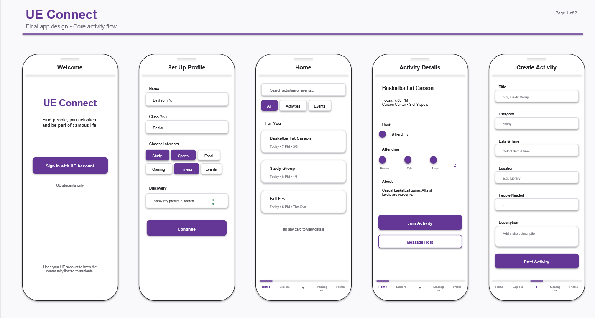
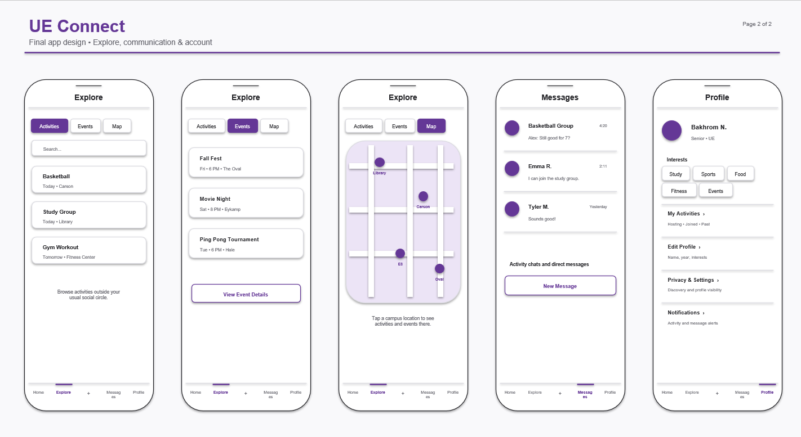
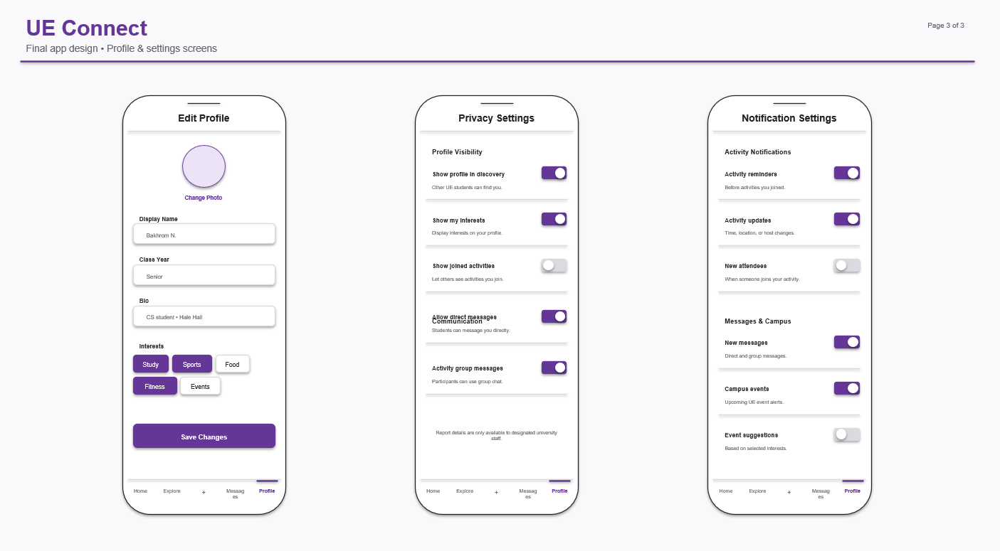

# UE Connect

## 1. Project Title

UE Connect

## 2. Project Description

UE Connect is a campus app for University of Evansville students that helps them find other students to do things with. A lot of times a student wants to study, get food, work out, play a sport, or go to a campus event, but nobody they know is free or interested at that time. It can also be hard to meet people outside of your own friend group, especially if you are new to campus or your schedule does not line up with your friends' schedules.

With UE Connect, a student can post an activity, like a pickup basketball game at Carson Center or a study group at the library, and other students can find it and join. Users will be able to set up a profile with their interests, browse and search activities posted by other students, create their own activities, join or leave activities, see who is hosting and who else is going, and message other students about an activity. The goal is to make it easier to find someone to do something with and to meet new people at UE.

## 3. Target Users

The main users are University of Evansville students, especially undergraduates who live on or near campus. These are students who:

- Want a study partner or study group for a class or before an exam.
- Want someone to eat with instead of going to the dining hall alone.
- Want a workout partner or enough people for a pickup game.
- Want to go to a campus event but do not want to go alone.
- Want to meet people outside their current friend group, such as first-year students, transfer students, or students whose friends have different schedules.

What these students need is a simple way to see what other students are doing right now or soon, decide if they want to join, and talk to the people involved before showing up. Since the app is only for UE students, everyone using it goes to the same school and the activities are all on or around campus.

## 4. Core Features

1. **User profiles and interests:** Users can create a basic profile with their name, class year, and a short bio, and pick interests such as study, sports, food, fitness, and events. Users can edit their profile later.

2. **Browse and search activities:** Users can view a list of upcoming activities posted by other students. They can search by keyword and filter by category, and open an activity to see its details.

3. **Create and manage activities:** Users can create an activity by entering a title, category, date and time, location, description, and the number of people needed. The host can edit the activity or cancel it.

4. **Join and leave activities:** Users can join an activity if there are open spots and leave it if their plans change. The activity page shows the host, the students who are attending, and how many spots are left. Users can see the activities they are hosting and the ones they have joined.

5. **Messaging:** Users can message the host of an activity and send messages in a group chat for an activity they joined. This lets students ask questions or coordinate details before meeting up.

## 5. Project Scope

I think this project can be finished in about eight weeks because the main idea is simple: students post activities and other students join them. Most of the work is standard create, read, update, and delete operations on users, activities, and participants. Messaging adds some extra work, but I plan to keep it basic (sending and viewing messages, without live typing indicators or read receipts). I am not trying to build a full social network.

**Essential functionality:**

- User accounts (sign up and log in)
- Creating and editing a profile with interests
- Viewing, searching, and filtering activities
- Creating, editing, and canceling activities
- Joining and leaving activities, with a participant limit
- Viewing the host and the list of attending students
- A "My Activities" view for activities the user is hosting or has joined
- Basic messaging with the host and with other participants

**Optional / stretch features:**

- Campus events tab with UE events listed alongside student activities
- Interactive campus map showing where activities are happening
- Notification settings and alerts for reminders, activity changes, and new messages
- More detailed privacy settings (hiding interests or joined activities, turning off direct messages)
- Profile photos
- Signing in with the actual UE university account instead of a regular account
- Live (real-time) chat updates
- Showing past activities

I will only work on these after the essential features are working.

**Expected challenges:**

- **User accounts and authentication:** Making sure users log in securely and that each request is tied to the right user.
- **Authorization:** Only the host should be able to edit or cancel an activity, and only participants should be able to see an activity's group chat.
- **Participation state:** Keeping the participant count correct, making sure an activity cannot go over its limit, and handling cases like a user leaving or an activity being canceled.
- **Messaging:** Deciding how to organize direct messages versus activity group chats, and how often to check for new messages.
- **Database relationships:** Users, activities, participants, and messages are all connected, so the relationships need to be set up carefully.
- **Validation:** Checking inputs like dates in the past, empty fields, and invalid participant limits on both the frontend and backend.

## 6. Initial UI Sketch

The sketches below show the overall layout and main screens of the app. They are not a final design, and some details will probably change once I start building the interface. The sketches also cover some ideas that I am treating as stretch goals (the campus events tab, campus map, privacy settings, and notification settings), so not everything shown is part of the essential features listed above.

The app uses a bottom navigation bar with five tabs: **Home**, **Explore**, **+** (create activity), **Messages**, and **Profile**.

### Page 1: Core activity flow

- **Welcome:** Sign-in screen. The app is limited to UE students.
- **Set Up Profile:** First-time setup where the user enters their name and class year and picks interests.
- **Home:** Search bar, filter buttons, and a list of activity cards. Tapping a card opens the activity details.
- **Activity Details:** Shows the title, time, location, open spots, host, attending students, and description, with buttons to join the activity or message the host.
- **Create Activity:** Form with title, category, date and time, location, number of people needed, and description.

### Page 2: Explore, messages, and profile

- **Explore (Activities tab):** Search and browse all activities.
- **Explore (Events and Map tabs):** Campus events list and campus map. *(Stretch goals)*
- **Messages:** List of activity group chats and direct messages, plus a button to start a new message.
- **Profile:** Shows the user's name, class year, and interests, with links to My Activities (hosting, joined, past), Edit Profile, Privacy & Settings, and Notifications.

### Page 3: Profile and settings

- **Edit Profile:** Change display name, class year, bio, and interests.
- **Privacy Settings:** Toggles for profile visibility and messaging. *(Mostly stretch goal; the basic version may only include showing or hiding the profile in search.)*
- **Notification Settings:** Toggles for activity and message alerts. *(Stretch goal)*

## 7. Initial Data Requirements

The application will need to store the following information:

- **Users:** name, UE email, login information, class year, and a short bio.
- **Interests:** the list of interests users can choose from (study, sports, food, fitness, events, etc.).
- **User interests:** which interests each user has selected.
- **Activity categories:** categories used to group and filter activities, such as study, sports, food, and fitness.
- **Activities:** title, category, date and time, location, description, participant limit, host, status (active or canceled), and when it was created.
- **Activity participants:** which users have joined which activities and when they joined.
- **Messages:** sender, message text, and time sent, along with either the recipient (for direct messages) or the activity (for group chats).

Optional features may later need:

- **Campus events:** event name, date and time, location, and description.
- **Notifications:** the user, notification type, message, and whether it has been read.
- **User settings:** privacy and notification preferences.
